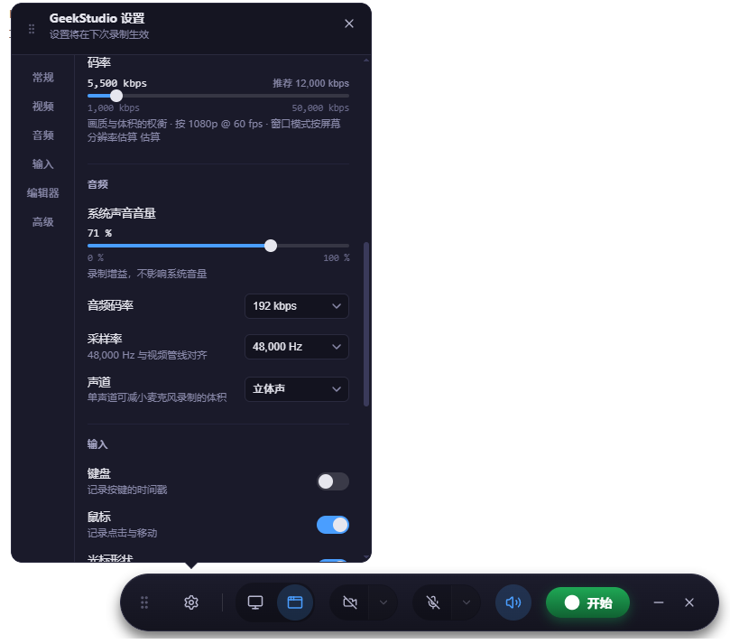
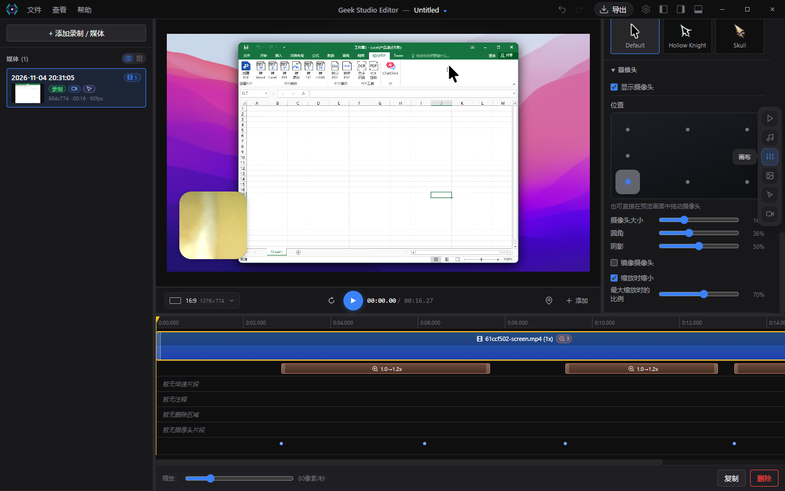
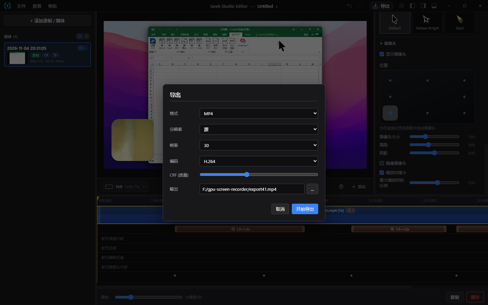

# Geek Studio Recorder

> Lightweight Windows screen recorder + video editor (two tools in one)
>
> **One-hotkey record → auto-open editor → noise reduction → export GIF/MP4** — a complete pipeline.

---

## Screenshots

---

## Two headline features

### ① One-hotkey recording, anytime

- Global hotkey **Ctrl+Alt+R** to start / stop (no need to switch windows)
- Three capture sources: **screen / window / region**
- **Microphone + system audio** captured together
- **Auto-opens the editor** when you stop — start editing immediately

<!-- Optional: if you make a demo GIF later, put docs/demo.gif and insert  above -->

### ② Edit right after recording

- **Timeline editing**: trim, crop, reorder
- **Audio denoise** (RNNoise): remove fan / background noise in one click
- Export **GIF / MP4** — share with friends, upload to video sites

<!-- Optional: put docs/demo.mp4 (or a Release link) and insert a video above -->

---

## Install

1. Download `GeekStudioRecorder-vX.Y.Z-win64.zip` from [Releases](https://github.com/YOUR_USERNAME/YOUR_REPO/releases) (Windows x64)
2. Extract to any folder (**all files stay in one folder**, ready to run)
3. Double-click `gsr-recorder.exe` to launch the recorder
4. **WebView2 runtime**: usually preinstalled on Windows 11 and recent Windows 10 (via Edge updates); if missing, install the [WebView2 Evergreen Runtime](https://developer.microsoft.com/microsoft-edge/webview2/)

## Feedback

We'd love your feedback! Open an [Issue](https://github.com/YOUR_USERNAME/YOUR_REPO/issues):

- Anything that feels **awkward** (hotkey, interaction, layout…)
- **New features** you'd like
- Bugs / crashes (please include reproduction steps + logs)

Real-world feedback is exactly what we need to polish this tool 🙏

---

**License**: MIT for the tools (see `LICENSE`); FFmpeg is LGPL v3+, RNNoise and Open Screen are BSD-3-Clause (see `THIRD-PARTY-NOTICES.txt` and `licenses/`).
