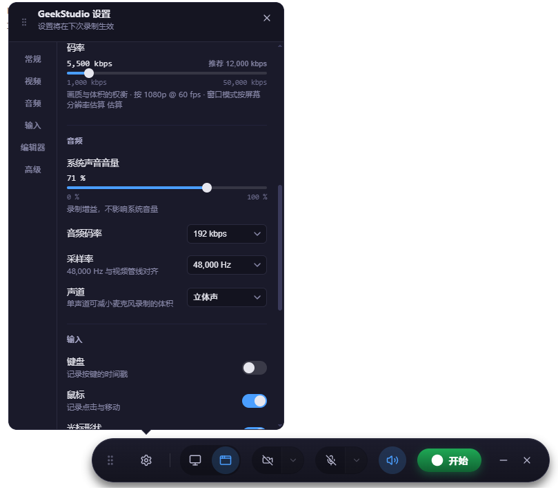
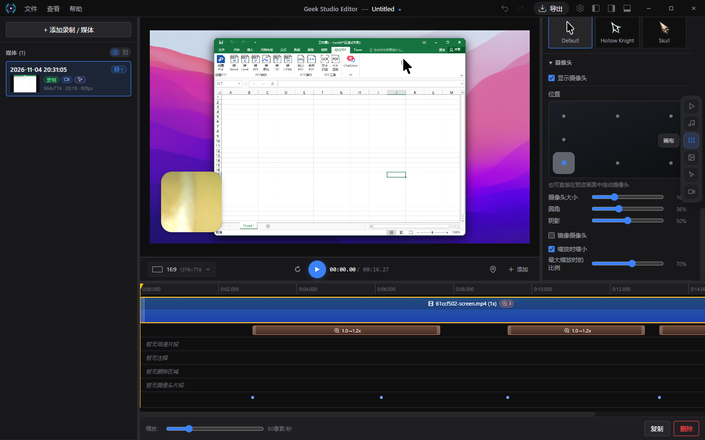
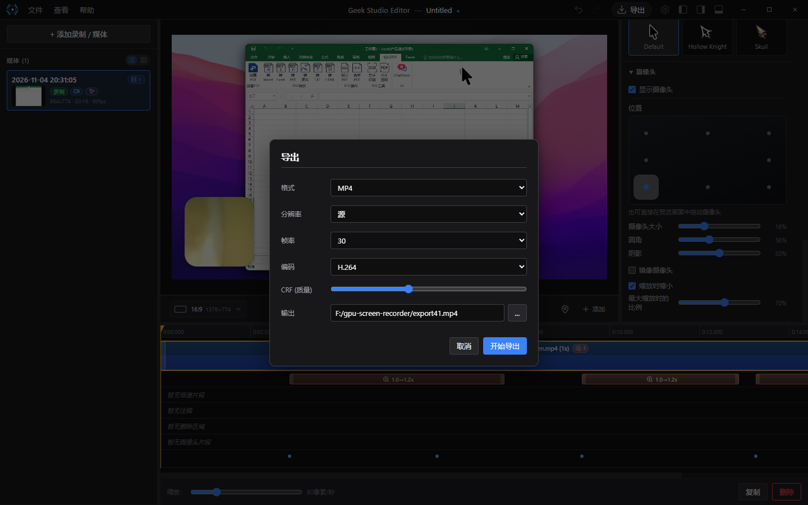

# Geek Studio Recorder

> 轻量级 Windows 屏幕录制 + 视频编辑工具（由两个工具组成）
>
> **一键录屏 → 自动进编辑器 → 音频降噪 → 导出 GIF/MP4** 的完整闭环。

---

## 截图

---

## 两大核心功能

### ① 一键录屏，随时开录

- 全局热键 **Ctrl+Alt+R** 开始 / 停止录制（不用切窗口）
- 三种录制源：**屏幕 / 窗口 / 区域**
- **麦克风 + 系统音** 同时录制
- 录制结束**自动打开编辑器**，直接开剪

<!-- 可选：若以后录了演示 GIF，放 docs/demo.gif 并在上方插入  -->

### ② 录制完直接编辑

- 时间线**剪辑**：掐头去尾、裁剪、排序
- **音频降噪**（RNNoise）：一键消除风扇 / 环境底噪
- 导出 **GIF / MP4**，分享给朋友、传 B 站都行

<!-- 可选：把演示 MP4 放 docs/demo.mp4（或 Release 链接），在上方插入视频 -->

---

## 安装

1. 从 [Releases](https://github.com/YOUR_USERNAME/YOUR_REPO/releases) 下载 `GeekStudioRecorder-vX.Y.Z-win64.zip`（Windows x64）
2. 解压到任意目录（**所有文件放在同一目录**，直接可用）
3. 双击 `gsr-recorder.exe` 启动录制器
4. **WebView2 运行时**：Windows 11 及较新的 Windows 10 通常已内置（经 Edge 更新）；若启动时提示缺少，安装 [WebView2 Evergreen Runtime](https://developer.microsoft.com/microsoft-edge/webview2/)

## 反馈 / 提意见

欢迎提意见！去 [Issues](https://github.com/YOUR_USERNAME/YOUR_REPO/issues) 反馈：

- 哪里用起来**不顺手**（热键、交互、布局……）
- 想要什么**新功能**
- 录屏 / 编辑**遇到问题**（附：复现步骤 + 崩溃日志，帮助定位）

我们非常需要你的真实反馈来打磨这个工具 🙏

---

**许可证**：工具本体为 MIT（见 `LICENSE`）；FFmpeg 为 LGPL v3+、RNNoise 与 Open Screen 为 BSD-3-Clause（见 `THIRD-PARTY-NOTICES.txt` 与 `licenses/`）。
